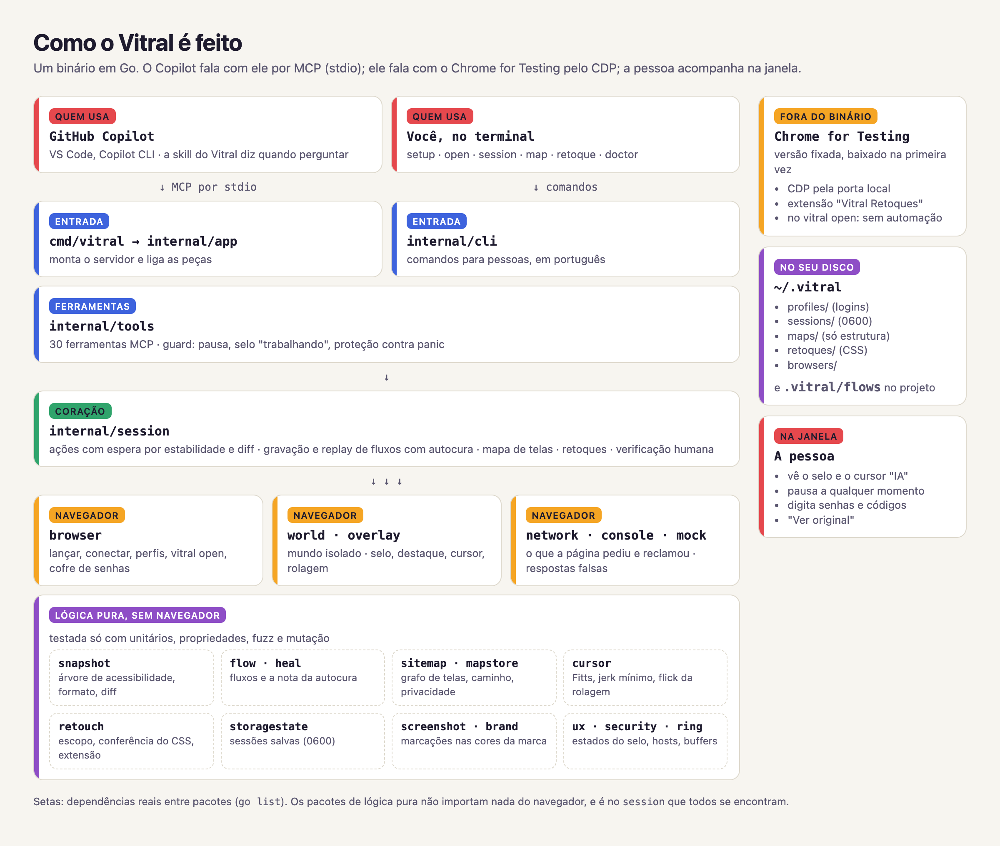

<p align="center">
  <picture>
    <source media="(prefers-color-scheme: dark)" srcset="assets/brand/logo-dark.png">
    
  </picture>
</p>

<p align="center"><strong>Uma janela que a IA consegue ler.</strong></p>

<p align="center">
  
  
  
  
  
</p>

O Vitral deixa o GitHub Copilot usar um navegador de verdade **enquanto você acompanha**: abrir telas,
preencher formulários, conferir o que a API respondeu, repetir tarefas gravadas e até mudar como um site
se parece no seu navegador. Cada pedaço da tela ganha um número e uma cor, você vê na janela o que a IA
vai fazer antes de ela fazer, e pode pausar quando quiser.

<p align="center">
  
  <br><sub>Gravação real: cada alvo pisca com o seu número antes da ação, o cursor "IA" mostra onde vai clicar e o selo diz o que está acontecendo.</sub>
</p>

<!-- TODO: GIF com o chat do Copilot ao lado do navegador (roteiro em docs/demo.md) -->

## Comece em 3 passos

1. **Baixe** o Vitral do seu computador na [página de versões](https://github.com/JonathanSantos/vitral/releases)
   e descompacte. (Ou compile: `go install github.com/JonathanSantos/vitral/cmd/vitral@latest`.)
2. **Rode** dentro da pasta do seu projeto, no terminal:

   ```bash
   vitral setup
   ```

   (no Mac, se aparecer um aviso de segurança na primeira vez: `xattr -d com.apple.quarantine vitral`)
3. **Abra o Copilot** no VS Code, no modo Agent, e peça do seu jeito: *"Abra o portal de pedidos e busque
   o pedido 1023."* Ou digite `/` e escolha um prompt do Vitral.

| Prompt | O que faz |
|---|---|
| `/vitral-descrever-tela` | Abre uma página e explica a tela em linguagem simples. |
| `/vitral-preencher-formulario` | Preenche um formulário com os dados que você colar e para antes de enviar. |
| `/vitral-testar-api-fora` | Mostra como a tela fica quando a API dá erro, demora ou cai. |
| `/vitral-gravar-fluxo` | Faz uma tarefa com você e salva para repetir depois. |
| `/vitral-executar-fluxo` | Repete uma tarefa gravada, passo a passo. |

O `vitral setup` também instala a **skill do Vitral**: as regras que o Copilot segue no navegador, como
explicar antes de agir, pedir um "sim" antes de enviar qualquer coisa e nunca digitar senhas.

## O que o Vitral faz

<table>
<tr>
<td width="50%" valign="top">

### A IA lê a tela, não adivinha

Cada ação devolve só o que mudou, num texto curto tirado da árvore de acessibilidade do Chrome: abrir
uma página custa de 60 a 230 tokens, um clique de 20 a 90. Quando cor e layout importam, o print vem
com os mesmos números desenhados por cima.

</td>
<td width="50%" valign="top">

<br><sub>O que a IA vê no <code>screenshot</code>.</sub>
</td>
</tr>
<tr>
<td width="50%" valign="top">

<br>
</td>
<td width="50%" valign="top">

### Você continua no controle

O selo diz o que a IA está fazendo e tem o botão de pausa. Senhas, códigos de verificação e CAPTCHAs
são sempre seus: o Vitral para, destaca o campo e mostra **"Sua vez"**. Ele nunca tenta resolver nem
contornar uma verificação.

</td>
</tr>
<tr>
<td width="50%" valign="top">

### Tarefas repetidas viram fluxos que se curam

A IA grava os passos, mostra a lista antes de salvar e repete quando você pedir, com parâmetros
(`{{numero}}`) e conferência no fim. Se o sistema mudar o texto de um botão, o fluxo encontra o botão
novo sozinho; num passo sensível ("Confirmar", "Pagar", "Excluir"), ele para e pergunta.

</td>
<td width="50%" valign="top">

```text
flow confirmar-pedido: 4 steps
2. stopped: click button "Confirmar"
Healing needed at step 2: was button
"Confirmar", best match [e4] button
"Confirmar pedido" (confidence 0.81).
Ask the user before continuing.
```

</td>
</tr>
<tr>
<td width="50%" valign="top">

```text
goto "Pedido <num>" from "Painel": 2 steps
1. ok click link "Pedidos"
2. ok click link "Ver detalhes"
done: 2/2 steps passed.
```

</td>
<td width="50%" valign="top">

### Um mapa das telas que você já usou

Sem robô varrendo o site: o Vitral aprende com os cliques que aconteceram. Depois, *"me leve ao detalhe
do pedido"* vira um `goto` pelo caminho mais confiável. O mapa guarda só estrutura, nunca nomes, CPFs
ou valores.

</td>
</tr>
<tr>
<td width="50%" valign="top">

### Retoques: o site do seu jeito

*"Deixa esse sistema com tema escuro"*, *"aumenta a fonte da tabela"*, *"esconde esse banner"*. A IA
mostra a prévia e o antes e depois, e só salva com o seu "sim". Vale só no seu navegador, com
**"Ver original"** a um clique. Depois é só usar com `vitral open`, sem a IA.

</td>
<td width="50%" valign="top">

</td>
</tr>
<tr>
<td width="50%" valign="top">

</td>
<td width="50%" valign="top">

### Um cursor que você consegue seguir

O cursor da IA se move como uma mão: arco leve, acelera e desacelera (lei de Fitts e jerk mínimo),
corrige o fim em alvos pequenos. É só visual: o clique de verdade é um evento simples no ponto onde ele
parou, e o navegador continua identificado. A rolagem também é humana, com atrito e sem saltos.
[O estudo completo](docs/CURSOR.md).

</td>
</tr>
</table>

E também: **API fora do ar sem tocar no servidor** (`mock_add` faz uma rota responder 500, demorar ou
cair, só neste navegador), **login uma vez e fluxos sem janela depois** (`session_save` e `--session`) e
**perfis separados** para homologação e produção (`--profile hml`).

## É seguro?

- **A IA usa um navegador próprio do Vitral**, baixado na primeira vez, com perfil separado do seu Chrome.
- **Quem digita senhas e códigos é você.** O Vitral pausa e mostra "Sua vez".
- **Você pode pausar a qualquer momento** pelo botão "⏸ Pausar IA" no canto da janela.
- **A IA pede um "sim" antes de enviar, salvar ou excluir**, pela skill; passos sensíveis de fluxos e do
  `goto` nunca seguem sem confirmação, e isso o próprio Vitral garante. Retoques e mocks valem só no seu
  navegador.
- **Nada sai do seu computador** além do que a IA já vê no chat. Logins ficam no cofre do sistema
  (Keychain, DPAPI ou libsecret); sessões salvas e mapas ficam só no seu usuário, com permissão 0600.

Algo estranho? Rode `vitral doctor`: ele confere tudo e diz o que fazer.

## Desligar o Vitral

- **Agora, no meio de uma tarefa:** "⏸ Pausar IA" no canto da janela do navegador.
- **Só nesta conversa:** no chat do Copilot, *Configure Tools* e desmarque o Vitral.
- **No VS Code:** extensões, seção *MCP SERVERS - INSTALLED*, botão direito em "vitral" e *Disable* (ou
  *MCP: List Servers*). No Copilot CLI: `/mcp disable vitral`.
- **Nos arquivos de configuração:** `vitral disable` (e `vitral enable` para ligar de novo); `vitral status`
  mostra onde ele está configurado.

## Como é feito

<p align="center">
  <picture>
    <source media="(prefers-color-scheme: dark)" srcset="docs/img/arquitetura-escuro.png">
    
  </picture>
</p>

Um binário em Go, sem Node e sem dependências do sistema. A lógica que dá para testar sem navegador
(snapshot, autocura, mapa, física do cursor, retoques) fica em pacotes puros, com testes de propriedade,
fuzz e mutação; a parte que fala com o navegador é coberta por testes de integração e de ponta a ponta
com o binário de release.

| Go de produção | Go de testes | JS injetado | Pacotes | Funções de teste | Cenários e2e | Ferramentas MCP |
|---|---|---|---|---|---|---|
| ~20,6 mil linhas | ~16,8 mil linhas | ~1,7 mil linhas | 36 | 386 (9 de fuzz) | 9 | 30 |

## Para desenvolvedores

```bash
make build         # bin/vitral
make check         # o gate: lint, vuln, unitários, integração, e2e, mutação, tempos e tokens
make readme-shots  # regrava os prints, GIFs e o diagrama deste README
```

- [Ferramentas, flags, navegador, sessões, retoques e testes](docs/DESENVOLVIMENTO.md)
- [Especificação](docs/SPEC.md) · [Testes](docs/TESTING.md) · [Identidade](docs/BRAND.md) ·
  [Cursor e rolagem](docs/CURSOR.md) · [Retoques](docs/RETOQUES.md) · [Snapshot](docs/SNAPSHOT-V2.md)
- [Avaliações com modelo real](docs/AVALIACAO-SONNET.md) · [Roteiro de validação manual](examples/vscode/CHECKLIST.md)
- [Como contribuir](CONTRIBUTING.md) · [Segurança](SECURITY.md) · [Licença MIT](LICENSE)

---

## Veredito do Claude

*Escrito pelo Claude (Opus 5.5), que ajudou a construir o Vitral: sou parte interessada. Separei o que
foi medido do que é opinião; os números vêm de [`docs/AVALIACAO-SONNET.md`](docs/AVALIACAO-SONNET.md) e
do gate.*

### Nota: 8,7 de 10

| Parte | Nota | Por quê |
|---|---|---|
| Proposta e experiência | 9,5 | A ideia é clara e coerente de ponta a ponta: a IA usa o navegador como um colega usando a sua tela, e a confiança vem de ver, pausar e confirmar |
| Engenharia e testes | 9,5 | Lógica pura separada do navegador, gate com mutação, fuzz, e2e com binário de release, tetos de tempo e de tokens, decisões tomadas com medição antes do código |
| Segurança e privacidade | 9,0 | Senhas, códigos, CAPTCHA, passos sensíveis e CSS que vaza dados são barrados pelo próprio Vitral; o clique comum em "Enviar" ainda depende da skill |
| Alcance técnico | 8,0 | Uma aba ativa, só o frame principal (iframes de fora), só Chromium |
| Validação no mundo real | 6,5 | Quatro rodadas com o Sonnet, mas nunca no Copilot de verdade; Linux e Windows só compilados, nunca executados; o CI nunca rodou no GitHub |
| Documentação | 9,5 | Especificações, medições e decisões escritas, README com material real |

A nota caiu de 9,0 para 8,7 desde a última avaliação: o projeto ganhou bastante (retoques, `vitral open`,
cofre de senhas) mais rápido do que ganhou uso de verdade.

### O que me convence

- **O modelo usa como foi desenhado.** Nas rodadas com o Sonnet, ele parou e perguntou em todos os pontos
  sensíveis, recusou contornar paywall mesmo quando a pessoa insistiu que o site era dela, e usou `goto`,
  `map_find` e os retoques sem ser mandado.
- **A autocura acerta o equilíbrio.** Troca de texto de botão com nota 1,00: corrige sozinho. "Confirmar"
  virando "Confirmar pedido", com 0,81 num passo sensível: para e pergunta.
- **As decisões difíceis foram medidas.** A porta de depuração faz todo site ver o navegador como
  automatizado; por isso o `vitral open` abre sem ela. O snapshot pela árvore de acessibilidade ganhou do
  antigo em sucesso e em tokens antes de virar o padrão.

### O que me preocupa

- **O mundo real ainda não falou.** Falta rodar com o modelo padrão do Copilot, numa instalação feita do
  jeito que uma pessoa faria, em Linux e Windows, e num sistema de verdade da sua empresa.
- **O primeiro CI no GitHub deve falhar por motivos de máquina:** os tetos de tempo foram medidos neste
  Mac, e o gate completo leva perto de 10 minutos aqui.
- **`internal/session` concentra muito** (cerca de 3,8 mil linhas): é o próximo lugar a dividir.
- **Uma aba e o frame principal.** Sistemas antigos e gateways de pagamento vivem em iframes.

### Eu usaria?

**Sim** para conferir o meu front-end enquanto desenvolvo, testar estados de erro com a API simulada,
reproduzir bugs em homologação junto com a pessoa, automatizar tarefas repetidas de back-office em
ambiente de teste, retocar sistemas internos que uso todo dia, e em demonstrações.

**Não** para suíte de regressão no CI (testes Playwright escritos à mão são mais baratos e
determinísticos), raspagem em escala, produção com ações irreversíveis sem ninguém olhando, ou
aplicações dentro de iframes.
