<p align="center">
  <picture>
    <source media="(prefers-color-scheme: dark)" srcset="assets/brand/logo-dark.png">
    
  </picture>
</p>

<p align="center"><strong>Uma janela que a IA consegue ler.</strong></p>

O Vitral deixa o GitHub Copilot usar um navegador de verdade enquanto você acompanha: abrir telas,
preencher formulários, tirar prints, conferir o que a API respondeu e repetir tarefas gravadas. Cada
pedaço da tela ganha um número e uma cor, e você vê na janela o que a IA vai fazer antes de ela fazer.

<p align="center">
  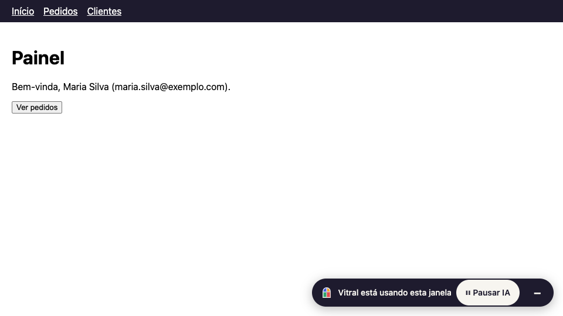
  <br><sub>Gravação real (<code>make readme-shots</code>): cada alvo pisca com a ref antes da ação, o cursor "IA" mostra onde vai clicar e o selo diz o que está acontecendo.</sub>
</p>

## Comece em 3 passos

1. **Baixe** o Vitral do seu computador na [página de versões](https://github.com/JonathanSantos/vitral/releases)
   e descompacte.
2. **Rode** dentro da pasta do seu projeto, no terminal:

   ```bash
   vitral setup
   ```

   (no Mac, se aparecer um aviso de segurança na primeira vez: `xattr -d com.apple.quarantine vitral`)
3. **Abra o Copilot** no VS Code, no modo Agent, digite `/` e escolha um prompt do Vitral.

## O que dá para pedir

| Prompt | O que faz |
|---|---|
| `/vitral-descrever-tela` | Abre uma página e explica a tela em linguagem simples. |
| `/vitral-preencher-formulario` | Preenche um formulário com os dados que você colar e para antes de enviar. |
| `/vitral-testar-api-fora` | Mostra como a tela fica quando a API dá erro, demora ou cai. |
| `/vitral-gravar-fluxo` | Faz uma tarefa com você e salva para repetir depois. |
| `/vitral-executar-fluxo` | Repete uma tarefa gravada, passo a passo. |

Ou peça do seu jeito: *"Abra o portal de pedidos e busque o pedido 1023."*

O `vitral setup` também instala a **skill do Vitral** (`.github/skills/vitral/`, ou `~/.copilot/skills/vitral/`
com `--global`): são as regras que o Copilot segue ao usar o navegador, como explicar antes de agir,
pedir um "sim" antes de enviar qualquer coisa e nunca digitar senhas. O Vitral funciona sem ela, mas
com ela a IA trabalha com mais cuidado. Se você editar a skill, o setup pergunta antes de trocá-la.

## O que tem de legal

### A IA lê a tela em texto, não em pixels

Cada ação devolve só o que mudou, num texto curto montado a partir da árvore de acessibilidade do
Chrome. É assim que a IA vê a lista de pedidos do GIF acima (saída do `click` em "Pedidos", resumida):

```text
page: "Pedidos - Mini ERP" (http://127.0.0.1:8766/mini/pedidos.html)
screen: "Lista de pedidos" (known)
[e1] banner
  [e2] navigation "Menu"
    [e3] link "Início"
    [e4] link "Pedidos"
    [e5] link "Clientes"
[e6] main
  [e7] heading "Lista de pedidos" level=1
  [e8] searchbox "Buscar pedido" type=search value=""
  [e9] button "Novo pedido"
  [e10] table "Número Cliente CPF Ação 10234 …" rows=2
    [e12] row "10234 | Maria Silva | 123.456.789-09 | Ver detalhes"
      [e13] link "Ver detalhes"
flow step #7
```

Nos cenários do e2e, abrir uma página custa de 60 a 230 tokens; um clique que muda parte da tela custa
de 20 a 90, e um que leva a outra página custa como um `open` (160 a 240). Os números de cada passo
ficam em `.quality/out/tokens.json` e têm teto no gate. Quando layout, cores ou imagens
importam, o `screenshot` devolve o print com as mesmas refs desenhadas por cima, para a IA ligar o que
vê ao que pode clicar:

| O que você vê | O que a IA vê no `screenshot` |
|---|---|
| 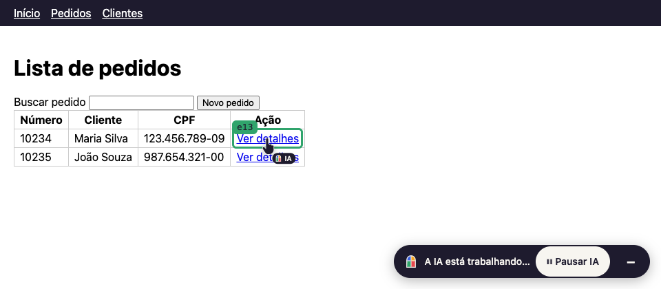 | 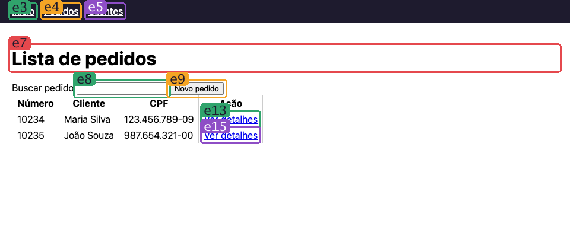 |

O selo, o destaque e o cursor são só para você: nunca entram no snapshot nem no print da IA.

O snapshot alcança shadow root fechado, divs clicáveis só por listener e conteúdo de slot, e as refs
ficam guardadas no Go: a página não as vê nem consegue forjá-las ([`docs/SNAPSHOT-V2.md`](docs/SNAPSHOT-V2.md)).

### Você continua no controle

<p align="center">
  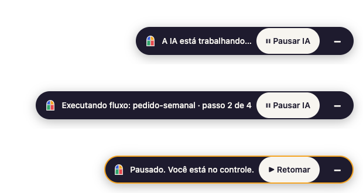
</p>

O selo no canto da janela diz o que a IA está fazendo e tem o botão de pausa. Pausado, as ferramentas
que agem respondem "pausado" (sem erro) e a IA espera; as de leitura continuam, para ela ver o que você
mudou quando você retomar.

Senhas, códigos de uso único (2FA) e CAPTCHAs são sempre seus. O Vitral não tenta resolver nem
contornar: ele para, destaca o campo e mostra "Sua vez".

<p align="center">
  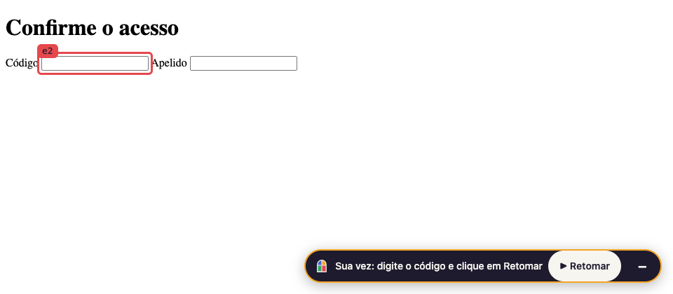
</p>

### Tarefas repetidas viram fluxos, e os fluxos se curam

Toda ação gravada vira um passo. Com `flow_save` a IA salva só os passos da tarefa (com prévia antes,
parâmetros como `{{numero}}` e o texto que confirma que deu certo), e o `flow_run` repete. Quando o
sistema muda, o fluxo procura o mesmo elemento pela assinatura dele (rótulo, região, título acima,
posição) e se corrige. Num passo sensível, ele **não** decide sozinho. Saída real depois de um deploy
que trocou "Confirmar" por "Confirmar pedido":

```text
flow confirmar-pedido: 4 steps
2. stopped: click button "Confirmar"
Healing needed at step 2: was button "Confirmar", best match [e4] button "Confirmar pedido"
(confidence 0.81). Ask the user before continuing. ...
```

Com o "sim" da pessoa, o fluxo retoma de onde parou (e reabre a página certa, se a IA tiver ido para
outra no meio-tempo):

```text
flow confirmar-pedido: 4 steps, resuming at step 2
reopened http://127.0.0.1:8767/app/sensivel.html (where the flow stopped)
2. ok (healed) click button "Confirmar"
3. ok click button "Continuar"
4. ok wait_for text "confirmar, continuar"
done: 3/3 steps passed.
```

`flow_update` grava a correção no arquivo e guarda a versão anterior em `.vitral/flows/.history/`.

### Um mapa das telas que você já usou

Sem crawler e sem LLM dentro do Vitral: ele aprende a estrutura do site com os cliques que de fato
aconteceram. Depois a IA pede "me leve até o detalhe do pedido" e o `goto` faz o caminho mais confiável,
conferindo a página antes de cada clique. Links de menu (cabeçalho, navegação, rodapé) aprendidos numa
tela valem nas outras telas com o mesmo menu:

```text
goto "Clientes" from "Lista de pedidos": 1 steps (the most reliable known way)
1. ok click link "Clientes"
done: 1/1 steps passed.
```

O mapa guarda só estrutura: papéis, nomes de botões e títulos. Nada de valores de campos, conteúdo de
tabelas, e-mails ou CPFs (números longos viram `<num>`).

### Retoques: o site do seu jeito

Peça para mudar como um site se parece, e a IA faz isso só no seu navegador: *"deixa esse sistema com
tema escuro"*, *"aumenta a fonte da tabela"*, *"esconde esse banner"*, *"destaca os pedidos
atrasados"*. O site, o servidor e as outras pessoas não mudam nada.

<p align="center">
  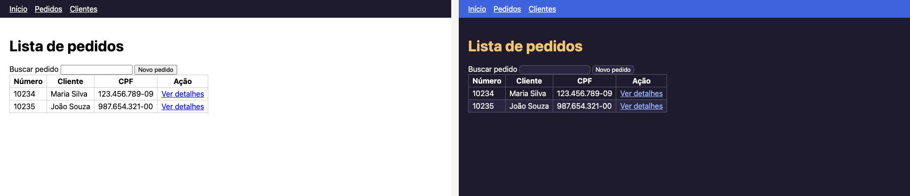
  <br><sub>O antes e o depois que a IA mostra antes de salvar (<code>retouch_save</code> com prévia).</sub>
</p>

1. **Experimente:** a IA aplica só na aba atual e diz o que cada regra pegou. Nada fica valendo ainda.
2. **Veja o antes e o depois:** o selo ganha **"Ver original"**, que alterna na hora, sem recarregar.
3. **Fixe com um "sim":** a IA mostra onde vai valer (esta página, o site todo ou todos os sites) e só
   salva depois da sua confirmação. Daí em diante, o retoque aparece sempre que o site abrir, já no
   carregamento, sem piscar o original.
4. **Ligue e desligue quando quiser:** o botão do Vitral na barra do navegador lista os retoques da aba,
   cada um com um interruptor, mais "Ver original" e "Desligar todos neste site".

<p align="center">
  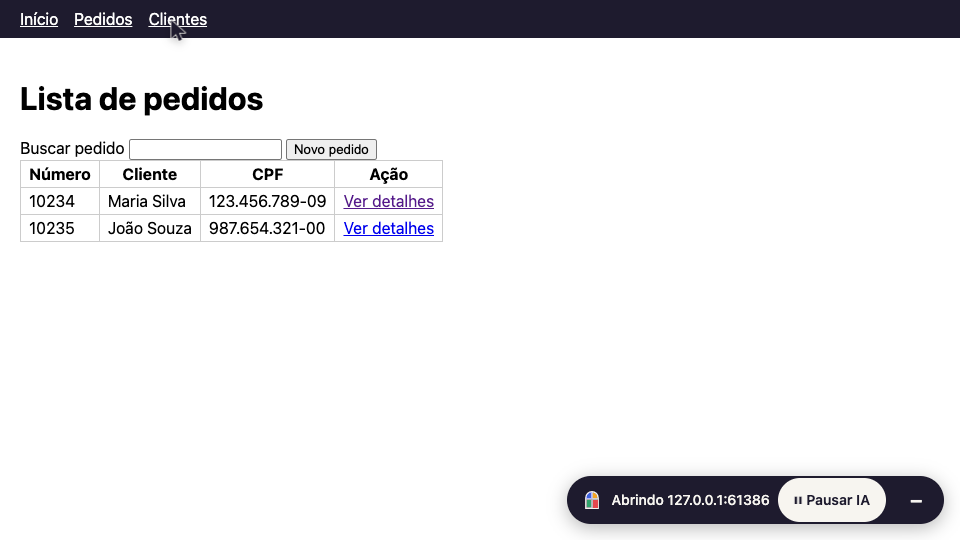
</p>

**Use o navegador retocado no dia a dia** com `vitral open`: ele abre o navegador do Vitral com os seus
retoques e os logins do perfil, sem a IA, como um Chrome comum (os sites não o veem como automatizado).

```bash
vitral open                     # o navegador do Vitral, com os retoques
vitral open sistema.empresa.com # já abre nesse endereço
vitral open --sem-retoques      # tudo desligado nesta janela
vitral retoque list             # os retoques salvos e onde valem
vitral retoque delete tema-escuro
```

Os logins valem nos dois: o que você fizer no `vitral open` vale quando a IA abrir o mesmo perfil, e vice-versa.
Os dois só não abrem o perfil ao mesmo tempo. Se a IA precisar do navegador enquanto o `vitral open`
estiver aberto, ela pede para você fechar a janela; se você rodar o `vitral open` com a IA trabalhando,
abre uma janela nova no navegador dela.

Retoques mudam a aparência; as tarefas (enviar, salvar, excluir) continuam com os fluxos, sempre com
o seu "sim". Um retoque que tente buscar algo em outro site é barrado até você confirmar (CSS também
consegue mandar para fora o que você digita), e a IA não retoca para contornar paywall ou verificação.

### E mais

- **API fora do ar sem tocar no servidor:** `mock_add` faz uma rota responder 500, demorar ou cair, só
  dentro deste navegador; `network_list` e `console_list` mostram o que a página pediu e reclamou.
- **Login uma vez, fluxos sem janela depois:** `session_save` guarda cookies e localStorage num
  arquivo só seu (0600); `--session` abre já logado, inclusive em `--headless`.
- **Perfis separados** para homologação e produção (`--profile hml`).

## O estudo do movimento: cursor e rolagem

Com a janela visível, o cursor da IA se move como uma pessoa moveria, para você conseguir acompanhar
com os olhos. O cursor é **só visual**. O clique de verdade é um evento simples no ponto onde o cursor
parou, sem passar por cima de nada no caminho. Ele não disfarça automação: o navegador continua
identificado como Chrome for Testing e o selo continua na tela. A física fica em Go puro
(`internal/cursor`), determinística pela semente e coberta por testes de propriedade, fuzz e mutação. O
overlay só desenha. Detalhes em [`docs/CURSOR.md`](docs/CURSOR.md).

<p align="center">
  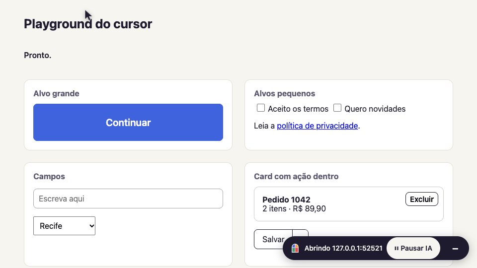
  <br><sub>Alvo grande, caixinha de 16 px (repare na correção no fim), link no meio do texto, digitação tecla a tecla e um card com "Excluir" dentro: o clique nunca cai no Excluir.</sub>
</p>

<p align="center">
  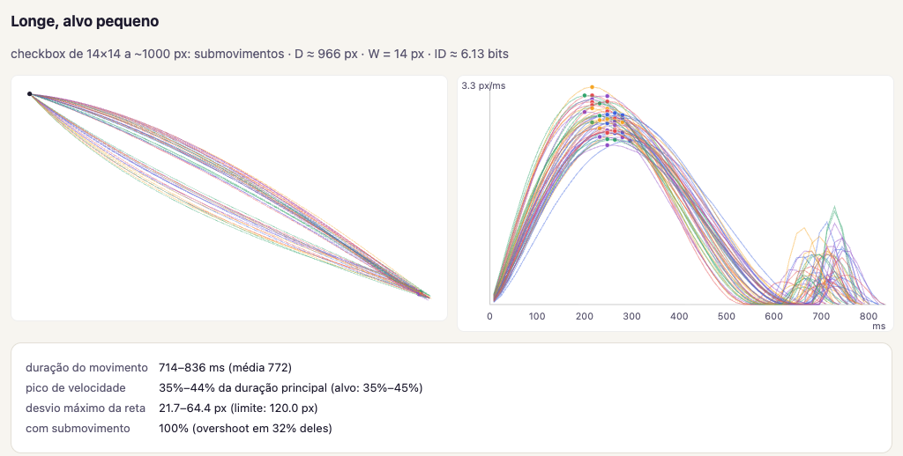
  <br><sub>50 movimentos até uma caixa de 14 px, a quase 1.000 px de distância (<code>make cursorlab</code>).</sub>
</p>

O que entra em cada movimento, e de onde vem:

| Ingrediente | Modelo | No Vitral |
|---|---|---|
| Quanto tempo leva | Lei de Fitts: alvo longe e pequeno demora mais | `T = 100 + 110·log2(D/W + 1)` ms, entre 250 e 900 ms |
| Que caminho faz | Mão não anda em linha reta | Curva de Bézier com arco de 4% a 12% da distância, lado sorteado (65% de chance de repetir) |
| Como acelera | Jerk mínimo (Flash e Hogan) | `s(τ) = 10τ³ − 15τ⁴ + 6τ⁵`, com o pico de velocidade entre 35% e 45% do tempo |
| Alvo difícil | Submovimentos | Com ID ≥ 3,5 bits: para antes (70%) ou passa do ponto (30%) e corrige |
| Mão de gente | Tremor | 0,4 px a 8–12 Hz, zerado nas pontas para nunca recuar |
| Onde clica | Ninguém clica no centro exato | Ponto sorteado em volta do centro, validado com `elementFromPoint`: nunca cai na lixeira dentro de um card nem na seta de um botão dividido |

A rolagem começou com um diagnóstico. A roda pelo CDP saltava 100 px por vez e deixava 78% dos frames
parados, e o `scrollIntoView` suave do Chrome levava ~630 ms em qualquer distância, com até 2.537 px num
único frame. O modelo novo é um "flick" com atrito, como o de um trackpad:

<p align="center">
  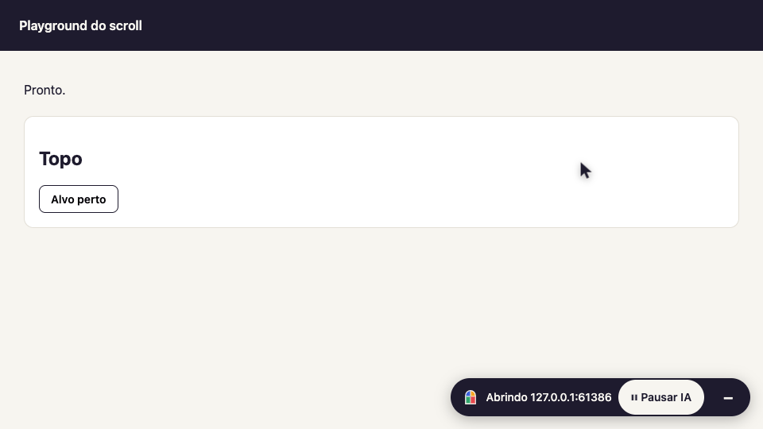
  <br><sub>Três telas para baixo, bem longe e de volta ao topo. O alvo sempre para entre 30% e 40% da altura visível, abaixo do cabeçalho fixo.</sub>
</p>

<p align="center">
  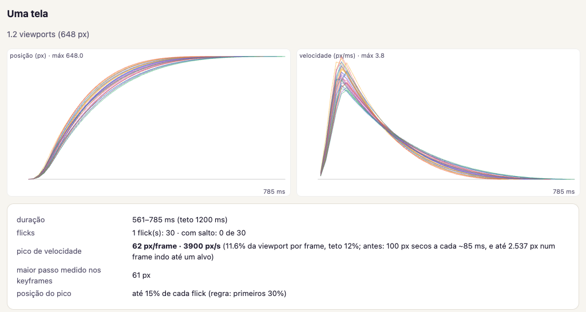
  <br><sub>Rolar uma tela: pico de velocidade nos primeiros 15% e parada sem tranco.</sub>
</p>

- pico em 60–90 ms e atrito exponencial que termina com velocidade **e** aceleração zero;
- teto de 12% da janela por frame (nada de saltos de 2.500 px) e de 1,2 s por rolagem;
- distâncias longas em vários flicks com pausa, e acima de 6 telas um salto até perto do alvo;
- o alvo para entre 30% e 40% da área visível, descontando cabeçalhos fixos;
- se você rolar com o seu mouse no meio, a animação para e respeita você.

`make demo-cursor` abre uma janela com um roteiro de cliques, digitação e rolagens em câmera lenta.
`--cursor-speed instant` (ou `--cursor off`) desliga a coreografia para quem só quer velocidade.

## É seguro?

- **A IA usa um navegador próprio do Vitral**, baixado na primeira vez, com perfil separado. O seu
  Chrome não é usado, a menos que você permita.
- **Quem digita senhas é você.** Quando aparece um campo de senha, o Vitral pausa e mostra "Sua vez".
- **Você pode pausar a qualquer momento** pelo botão "⏸ Pausar IA" no canto da janela do navegador.
- **O cursor da IA é só visual.** Ele mostra, com a etiqueta "IA", onde a IA vai clicar, para você
  acompanhar. O clique de verdade acontece no ponto onde o cursor parou, sem passar por cima de nada
  no caminho. Ele não serve para disfarçar automação: o navegador continua identificado e o selo
  continua na tela. Para desligar: `"--cursor", "off"` em `args`.
- **Nada sai do seu computador** além do que a IA já vê no chat.

Algo estranho? Rode `vitral doctor`: ele confere tudo e diz o que fazer.

## Desligar o Vitral

Do mais rápido ao mais duradouro:

- **Agora, no meio de uma tarefa:** clique em "⏸ Pausar IA" no canto da janela do navegador.
  <br>
- **Só nesta conversa:** no chat do Copilot, clique no botão *Configure Tools* (o ícone de
  ferramentas, ao lado de onde você digita) e desmarque o Vitral.
  <!-- print: Configure Tools com o Vitral desmarcado -->
- **No VS Code, até você ligar de novo:** na barra lateral de extensões, seção *MCP SERVERS - INSTALLED*,
  clique com o botão direito em "vitral" e escolha *Disable*. Também dá pelo comando *MCP: List Servers*:
  escolha "vitral" e depois *Disable*. Vale para este projeto ou para todos, e não muda nenhum arquivo.
  <!-- print: menu Disable no servidor vitral -->
- **No Copilot CLI:** `/mcp disable vitral`.
- **Nos arquivos de configuração:** `vitral disable` desliga o Vitral em todos os arquivos onde ele está
  (`--workspace` só nesta pasta, `--global` só no usuário); `vitral enable` liga de novo. Para ver onde
  ele está configurado: `vitral status`.

---

## Para desenvolvedores

Servidor MCP (stdio) em Go, binário único, que controla um Chromium via [rod](https://github.com/go-rod/rod).
Especificação em [`docs/SPEC.md`](docs/SPEC.md), identidade em [`docs/BRAND.md`](docs/BRAND.md), experiência
de uso em [`docs/UX-TASKS.md`](docs/UX-TASKS.md) e roteiro de validação manual em
[`examples/vscode/CHECKLIST.md`](examples/vscode/CHECKLIST.md).

### Ferramentas MCP

| Grupo | Ferramentas |
|---|---|
| Navegação e ações | `open`, `snapshot`, `click`, `type`, `select`, `press`, `scroll`, `wait_for`, `back` |
| Visão | `screenshot` (com marcações por ref), `inspect` |
| Rede e console | `network_list`, `network_get`, `console_list` |
| Simulação | `mock_add`, `mock_list`, `mock_clear`, `emulate` |
| Fluxos | `flow_save`, `flow_list`, `flow_run`, `flow_update` |
| Sessões | `session_save` |
| Mapa de telas | `goto`, `map_find` (desligados com `--no-map`) |
| Retoques | `retouch_preview`, `retouch_discard`, `retouch_save`, `retouch_list`, `retouch_toggle` (desligados com `--no-retouches`) |
| Opcional | `eval_js` (só com `--allow-eval`) |

As ações devolvem só o que mudou na tela. Enquanto a pessoa pausa, as ferramentas que agem respondem
(sem erro) que estão pausadas, e as de leitura continuam funcionando.

### Comandos e configuração

```bash
vitral                   # no terminal: ajuda; sem terminal (VS Code): servidor MCP
vitral setup [--global] [--yes]
vitral status
vitral disable [--workspace|--global]
vitral enable [--workspace|--global]
vitral session save <nome> [--profile p] | list | delete <nome>
vitral map list | show <site> | export <site> --to arquivo.json | import arquivo.json | clear <site>
vitral open [endereço] [--profile p] [--sem-retoques]
vitral retoque list | delete <nome>
vitral doctor
vitral install-browser [--from chrome.zip]
vitral version
```

Cursor visual da IA ([`docs/CURSOR.md`](docs/CURSOR.md)), com janela visível:

| Flag | Valores | Padrão |
|---|---|---|
| `--cursor` | `on`, `off`, `force` (liga mesmo sem janela visível: testes e gravação de demos) | `on` |
| `--cursor-speed` | `slow`, `normal`, `fast`, `instant` | `normal` |
| `--flow-cursor-speed` | idem, durante `flow_run` | `fast` |
| `--cursor-seed` | inteiro (0 = aleatória por sessão) | `0` |
| `--type-pacing` | `on`, `off` (digitação tecla a tecla, só com janela visível) | `on` |

### Navegador

O Vitral usa o próprio Chrome for Testing, em versão fixada (`install.PinnedVersion`), instalado em
`~/.vitral/browsers/<versão>` (mantém só a atual e a anterior). A escolha segue esta ordem, e o motivo
aparece no log (stderr) e no `vitral doctor`:

1. `--browser-path` ou `VITRAL_BROWSER_PATH`;
2. Chrome for Testing gerenciado (baixa se faltar, validando com `--version` antes de instalar);
3. se o download falhar ou não houver build para a plataforma: o Chromium mais novo do cache do
   Puppeteer ou do Playwright (só o executável; nada de Node);
4. Chrome ou Edge do sistema, **só com `--allow-system-browser`**, sempre com o perfil do Vitral.

Redes corporativas: `VITRAL_BROWSER_MIRROR` (ou `--browser-mirror`) aponta para um mirror com o mesmo layout
de paths do Chrome for Testing, `HTTPS_PROXY`/`HTTP_PROXY` são respeitados, e
`vitral install-browser --from chrome.zip` instala um zip baixado à mão.

O `setup` instala o binário em `~/.vitral/bin` e grava a configuração no formato portável, que vale
para o VS Code (todos os perfis), o Copilot CLI e o Agent Host: `.mcp.json` na raiz do projeto, ou
`~/.copilot/mcp-config.json` (`$COPILOT_HOME/mcp-config.json`) com `--global`, na chave `mcpServers`,
preservando comentários e com `.bak` do arquivo anterior. Se o Vitral estiver no formato antigo do VS Code
(`.vscode/mcp.json` ou o `mcp.json` de um perfil, deprecados), o setup oferece tirá-lo de lá: com ele em
dois lugares, o VS Code sobe dois servidores. Rodar de novo com um binário novo é a forma de atualizar.

Não existe campo oficial de "desligado" no arquivo (o VS Code e o Copilot CLI guardam esse estado à
parte). Por isso o `vitral disable` move a entrada de `mcpServers` para a chave de topo `_disabled`: o
arquivo continua JSON válido para todas as ferramentas e o `enable` só a devolve. Os dois são
idempotentes, mostram cada arquivo alterado e guardam `.bak`.

Flags do servidor (também aceitas em `vitral.yaml` no diretório de trabalho):

| Flag | Padrão | Descrição |
|---|---|---|
| `--headless` | `false` | Navegador sem janela. |
| `--attach ws://…` / `--attach-port 9222` | | Conecta num Chrome aberto com `--remote-debugging-port` e um `--user-data-dir` separado. Nunca o fecha. |
| `--profile` | `default` | Perfil nomeado em `~/.vitral/profiles/<nome>` (contas diferentes, homologação e produção). |
| `--profile-dir` | | Pasta de perfil explícita (vence `--profile`). |
| `--session` | | Começa com um perfil temporário e o login salvo por `session_save`. |
| `--sessions-dir` | `~/.vitral/sessions` | Onde ficam as sessões salvas. |
| `--no-map` | `false` | Não aprende o mapa de telas. |
| `--no-retouches` | `false` | Não carrega nem cria retoques (as ferramentas `retouch_*` somem). |
| `--retouches-dir` | `~/.vitral/retoques` | Onde ficam os retoques (uma pasta cada). |
| `--password-store` | `system` | Onde o navegador guarda a chave de cookies e senhas: `system` (Keychain, DPAPI, libsecret) ou `mock` (chave fixa, só para testes). |
| `--maps-dir` | `~/.vitral/maps` | Onde fica o mapa de cada host (privado, por usuário). |
| `--browser-path` | | Usa este executável (env `VITRAL_BROWSER_PATH`). |
| `--browser-mirror` | | Mirror do Chrome for Testing (env `VITRAL_BROWSER_MIRROR`). |
| `--allow-system-browser` | `false` | Permite o Chrome/Edge instalado como último recurso. |
| `--browsers-dir` | `~/.vitral/browsers` | Onde ficam os Chrome for Testing baixados. |
| `--allowed-hosts` | | Hosts permitidos para navegação e mock (globs, separados por vírgula). |
| `--allow-eval` | `false` | Registra `eval_js`. |
| `--disable-mock` | `false` | Remove as ferramentas de mock. |
| `--highlight-ms` | `350` (0 em headless) | Tempo do destaque antes de cada ação; `0` desliga. |
| `--no-overlay` | `false` | Sem destaque e sem texto no selo; o botão de pausa continua. |
| `--stability-timeout` | `10s` | Espera máxima para a página assentar depois de cada ação. |
| `--nav-timeout` | `15s` | Tempo máximo de navegação. |
| `--flows-dir` | `.vitral/flows` | Onde os fluxos são salvos. |
| `--log-level` | `info` | Logs sempre em stderr; stdout é só do protocolo MCP. |

### Perfis e sessões

- **Perfis nomeados:** `--profile hml` usa `~/.vitral/profiles/hml`; o selo e o `vitral status` mostram o
  perfil quando não é o `default`. O perfil antigo (`~/.vitral/profile`) vira o `default` na primeira
  execução (só se o destino não existir).
- **Sessões:** o Chrome não abre o mesmo perfil duas vezes. Para rodar fluxos sem janela (ou em outra
  máquina) com o login feito à mão, salve o estado: a ferramenta `session_save` na conversa, ou
  `vitral session save <nome>` com o Vitral fechado. Ficam salvos os **cookies e o localStorage das origens
  visitadas**, em `~/.vitral/sessions/<nome>.json`, com permissão 0600. `--session <nome>` usa um perfil
  temporário e restaura o estado **antes da primeira navegação**: o localStorage já existe quando o
  primeiro script da página roda. A IA nunca vê o conteúdo, só o nome, as origens, a data e a quantidade
  de cookies.
- **Riscos:** o arquivo dá acesso às contas. Não compartilhe, nunca coloque no git (o `setup` não cria
  nada disso no projeto) e apague com `vitral session delete <nome>` quando não precisar mais.
- **Limites:** IndexedDB e sessionStorage não entram; alguns sites guardam o login ali e vão pedir login de
  novo. Sessão expirada: o fluxo falha normalmente; faça o login de novo com a janela aberta e salve outra
  vez. Medição que decidiu o método (o DOMStorage do CDP não alcança uma origem fechada; uma aba temporária
  na própria origem, com a requisição interceptada e sem rede, leva ~90 ms por origem) em
  `internal/browser/state.go`.

### Autocura dos fluxos

Cada passo gravado guarda, além do seletor (papel + nome), uma assinatura do elemento: label,
placeholder, `data-testid`, `id` (só se não parecer gerado), `name`, caminho do `href`, tipo do campo e o
contexto (região, dialog, título acima, cabeçalhos da tabela, posição entre iguais e na página). Quando o
seletor não acha exatamente o elemento, o `flow_run` pontua os candidatos (`internal/heal`, puro) e só
aceita com nota ≥ 0,75, margem ≥ 0,15 sobre o segundo e papel compatível (botão ↔ link; o tipo do campo
nunca troca). O relatório lista os passos curados, e `flow_update` com `applyHealing=true` regrava o
fluxo, com a versão anterior em `.vitral/flows/.history/`.

**Quando pede confirmação:** num passo sensível (o nome antigo ou o novo tem uma palavra do léxico em
`internal/heal/sensitive.txt`, como confirmar, pagar, excluir ou enviar, ou é o último clique do fluxo) a
autocura nunca é automática: o `flow_run` para e pede para perguntar à pessoa; para seguir,
`resumeFrom=N` e `acceptHealing=true`. Por fluxo, `heal: ask` pergunta sempre e `heal: off` desliga.

### Retoques

Especificação, medições e decisões em [`docs/RETOQUES.md`](docs/RETOQUES.md).

- **Formato:** `~/.vitral/retoques/<nome>/retoque.yaml` (nome, descrição, escopo, padrões de URL do
  Chrome) e `style.css`, com 0700/0600 e versões anteriores em `.history/`. Só código, nunca dados da
  página. Escopo `page`, `site` (padrão) ou `all`; padrões sem porta valem em todas as portas do host.
- **Extensão gerada:** todos os retoques viram a extensão MV3 "Vitral Retoques" em `.build/`, com um
  content script por retoque em `document_start` (o `<style>` já vale no primeiro script da página),
  o painel e o número no ícone. Entra no lançamento com `--load-extension` (só se houver retoque) e é
  recarregada sem reiniciar com `Extensions.loadUnpacked` a cada save (~33 ms medidos). Precisa do
  Chrome for Testing: o Chrome comum ignora essas duas formas de carregar extensão.
- **Prévia:** um `<style>` no mundo isolado do Vitral, só na aba, com a contagem do que cada regra pegou.
  "Ver original" é um atributo no `<html>`, o ponto em comum entre o mundo do Vitral e o da extensão.
- **Conferência:** o save recusa CSS com `url()`, `@import`, `image-set()` ou `@font-face` de outro host
  (com os escapes do CSS desfeitos antes), salvo com `ignoreWarnings=true`.
- **`vitral open`:** monta o comando do Chrome à mão, só com `--user-data-dir`, as extensões e a chave do
  perfil: sem as bandeiras de automação e sem porta nem pipe de depuração (qualquer um dos dois já faz
  `navigator.webdriver = true` em todas as abas, medido). Solto do terminal (`setsid` /
  `DETACHED_PROCESS`).
- **Cofre de senhas:** a sessão da IA e o `vitral open` decidem a chave do perfil pela mesma regra
  (`--password-store system` por padrão). No macOS, perfis antigos (criados com `use-mock-keychain`)
  migram uma vez: cookies lidos com a chave antiga, só em memória, e regravados com a do Keychain; a
  marca só é gravada depois do sucesso. No Windows e no Linux nada muda.

### Mapa de telas

O Vitral aprende a estrutura de cada site com as ações que de fato aconteceram (nada de crawler, sem
LLM): telas (padrão de URL + impressão estrutural, Jaccard ≥ 0,7), transições (com sucessos, falhas e
último uso) e os elementos usados em cada tela. O snapshot de uma tela conhecida ganha a linha
`screen: "Lista de pedidos" (known) · exits: "Novo pedido" → "Cadastro de pedido"`; `goto` vai até uma
tela pelo caminho mais confiável (executado como fluxo, com autocura, sem atravessar passo sensível sem
pedir), e `map_find` procura telas e elementos já vistos. O mapa nunca substitui a leitura da página.
A linha `screen:` aparece no `open`, no `snapshot` e em toda ação que leva a uma tela conhecida.

**Menus globais:** um link aprendido numa tela vale nas outras quando está num landmark de navegação
(`navigation`, `banner` ou `contentinfo`) e a outra tela tem esse landmark com o mesmo item. Essas
arestas são calculadas na hora da busca (nunca gravadas), custam +0,15 a mais que uma aresta já
percorrida ali, e uma aresta observada com a mesma ação sempre vence. Links do conteúdo não viram globais.

- **Guarda só:** papéis, nomes de controles, títulos, regiões, cabeçalhos de tabela e padrões de URL
  (segmentos de ID viram `:id`; da query, só as chaves). Sequências de 4 ou mais dígitos, e-mails, CPF,
  CNPJ e telefones viram marcadores (`<num>`, `<email>`…).
- **Nunca guarda:** valores de campos, conteúdo de células, parágrafos, nem valores de query.
- **Onde:** `~/.vitral/maps/<site>.json` (0600, por usuário). Arestas que falham 3 vezes seguidas saem
  das sugestões; telas e arestas não vistas há 90 dias somem. `vitral map export/import` compartilha com
  a equipe; `--no-map` desliga.
- **Ganho medido** no mini-sistema de teste (`TestScreenMapMiniSystem`): ir de Clientes até o detalhe de
  um pedido leva 4 chamadas e ~663 tokens à mão (ler a tela e clicar) e 1 chamada e ~149 tokens com `goto`.

### Verificação humana: CAPTCHA e 2FA

O Vitral não resolve nem contorna verificações. Com a janela visível, ele pausa e mostra "Sua vez":
"resolva a verificação" para CAPTCHAs visíveis (reCAPTCHA, hCaptcha, Cloudflare Turnstile; os invisíveis
não contam) e "digite o código" para campos `autocomplete="one-time-code"`, nos quais a IA nunca digita.
Sem janela (`--headless`), a resposta é `verification required: run with the browser window visible`. A
lista de detectores fica versionada em `internal/session/verification.json`, com fixtures que imitam a
estrutura de cada serviço em `testdata/pages/verify`.

### Arquitetura

```
cmd/vitral          entrada: comandos para pessoas ou servidor MCP
internal/cli        setup, doctor, version e mensagens em PT-BR
internal/app        monta o servidor
internal/tools      ferramentas MCP (guard: pausa, selo "trabalhando", proteção contra panic)
internal/session    ações, espera por estabilidade, diff, gravação e replay de fluxos
internal/snapshot   JS embutido que lê a página + formatação e diff em Go
internal/overlay    selo, destaque, pausa e cursor visual injetados na página (shadow root fechado)
internal/cursor     física do cursor visual (pura, determinística pela semente)
internal/ux         máquina de estados do selo (pura)
internal/screenshot marcações desenhadas em Go
internal/heal       autocura dos fluxos: assinatura, nota e decisão (pura)
internal/storagestate sessões salvas (cookies e localStorage, arquivos 0600)
internal/sitemap    mapa de telas: grafo, caminho e privacidade (puro)
internal/retouch    Retoques: armazenamento, escopo, conferência do CSS e a extensão gerada (puro)
internal/mapstore   gravação dos mapas (atômica, com debounce)
internal/network, console, mock, flow, browser, security, brand, config, ring
tools/brandgen      gera os PNGs da marca (não entra no binário)
tools/cursorlab     laboratório do movimento do cursor (make cursorlab)
```

### Limitações conhecidas

- **Pausar só com o teclado não funciona na v1.** Os botões do selo têm `tabindex="-1"` para que um
  `press Tab` da IA não caia neles e mude o foco da página. Quem usa apenas o teclado ainda não consegue
  pausar.

### Próxima versão

- Atalho de teclado para pausar e retomar, resolvendo a limitação acima sem expor os botões do selo
  à navegação por Tab da página.

### Testes e build

A estratégia completa está em [`docs/TESTING.md`](docs/TESTING.md) e os números do gate em
[`.quality/thresholds.yaml`](.quality/thresholds.yaml).

```bash
make check-fast    # lint + unitários com race + cobertura unitária (o mesmo do pre-push)
make check         # gate de PR: check-fast + govulncheck + integração + e2e + mutação + qualitygate
make integration   # integração com Chromium headless e páginas de testdata/
make visual        # regressão visual com navegador (make visual-update aceita as mudanças)
make matrix        # compila e checa os testes para Linux, macOS e Windows
make install-test  # instalação e atualização com binários reais
make nightly       # check + mutação completa + fuzz + download real + visual + matriz
make release-check # nightly + install-test (rodar em cada sistema)
make network       # download real do Chrome for Testing (≈150 MB, fora do gate)
make cursorlab     # laboratório do cursor: trajetórias, velocidade e palco
make readme-shots  # regrava os prints e GIFs do README (docs/img) com o navegador de verdade
make demo-cursor   # janela visível com o roteiro do cursor em slow (para o GIF)
make build         # bin/vitral
make dist          # binários para Windows, macOS e Linux em dist/
make brand         # regenera os PNGs de assets/brand
```

Para um agente que não tem o Vitral como servidor MCP (simulações e avaliação com modelo real), a
ponte `tools/mcpbridge` sobe o binário real e expõe as ferramentas por HTTP local
(`GET /tools`, `POST /call`), com o registro de cada chamada:

```bash
go run ./tools/mcpbridge -log transcript.md -- bin/vitral --cursor-speed normal
```

Para rodar o gate rápido antes de cada push, ative o hook uma vez por clone:

```bash
git config core.hooksPath .githooks
```

O CI (`.github/workflows/pr.yml`) só chama `make check`. Releases com `goreleaser release --clean` a
partir de uma tag.

---

## Análise sincera (Claude)

*Escrita pelo Claude (Opus 5.5), que ajudou a construir o Vitral. Leve isso em conta: sou parte
interessada. Tentei separar o que foi medido do que é opinião. Os números vêm de
[`docs/AVALIACAO-SONNET.md`](docs/AVALIACAO-SONNET.md).*

### A proposta

Já existem bons servidores MCP de navegador. A aposta do Vitral não é fazer mais coisas que eles; é
fazer a IA usar o navegador **como um colega usando a sua tela, com você olhando**. Tudo se encaixa
nessa aposta: o selo com o botão de pausa, o destaque antes do clique, o cursor que você consegue
seguir com os olhos, o "Sua vez" em senhas e códigos, e o pedido de "sim" antes de qualquer envio. Acho
a aposta certa. O problema real de dar um navegador a uma IA não é ela não conseguir clicar; é a pessoa
não confiar no que está acontecendo. O Vitral ataca a confiança, não só a capacidade.

### O que funciona, com evidência

- **O modelo usa bem.** Em duas rodadas com o Sonnet 5.5, a segunda terminou sem nenhum erro inesperado
  nos cinco cenários. Ele parou e perguntou em todos os pontos sensíveis, não tentou digitar o código de
  SMS nem contornar o CAPTCHA, e usou `goto` e `map_find` sem ser mandado.
- **A autocura acerta o equilíbrio.** Um botão renomeado ("Salvar alterações" → "Salvar as alterações")
  foi corrigido sozinho, com nota 1,00. Já "Confirmar" → "Confirmar pedido", com 0,81 e num passo
  sensível, parou e pediu. É o comportamento que eu esperaria de uma pessoa cuidadosa.
- **É barato em tokens.** O diff por ação e a árvore de acessibilidade deixam uma tela inteira em
  centenas de tokens, não em milhares, e o `goto` corta uma navegação de 4 chamadas para 1.
- **A engenharia é séria.** São cerca de 34 mil linhas de Go e mais de 350 funções de teste. O gate tem
  mutação, e2e com binário de release, tetos de tempo e de tokens, e regressão visual. Os defeitos que o
  modelo encontrou viraram testes antes de virar correção.

### O que me preocupa

- **Parte da segurança depende do modelo seguir a skill.** Senhas, 2FA, CAPTCHA, passos sensíveis na
  autocura e no `goto` são barrados pelo próprio servidor. Mas um `click` comum em "Enviar pedido" não é:
  quem segura esse clique é a regra "peça um sim" da skill. Um modelo que ignore a skill pode enviar.
  Para o uso pretendido (ambientes de teste, com a pessoa olhando) isso é aceitável, mas precisa estar
  dito.
- **Validação fora do laboratório ainda é pouca.** Fora a Wikipédia, os testes rodaram em fixtures
  feitas para o projeto. Ainda falta testar no Copilot de verdade, com o modelo padrão dele, e em
  sistemas reais.
- **Limites de alcance:** só o frame principal (iframes ficam de fora, e sistemas legados e
  gateways de pagamento usam muito), só Chromium, e o mapa só conhece telas já visitadas.
- **A autocura é heurística.** Ela resolve renomear, mover e trocar id; um redesenho da tela quebra o
  fluxo, e os limiares (0,75 e 0,15 de margem) foram ajustados em fixtures.
- **O capricho visual custa tempo.** Com a janela visível, cada clique leva perto de 1 s de coreografia.
  É o preço de dar para acompanhar, e o `--cursor-speed instant` existe para quem não quer pagar.

### Eu usaria?

**Sim**, e com gosto, nestes cenários:

1. **Conferir o meu próprio front-end durante o desenvolvimento:** abrir o `localhost`, clicar no que
   mudei, olhar `console_list` e `network_list`, e você vendo tudo na janela.
2. **Testar estados de erro sem mexer no backend:** com `mock_add` a API devolve 500, demora 10 s ou
   cai, e eu descrevo como a tela reagiu. É o uso em que o Vitral mais economiza tempo de gente.
3. **Explorar e reproduzir bugs em homologação** junto com a pessoa: ela vê, pausa, mostra o caminho, e
   eu continuo de onde ela parou.
4. **Tarefas repetidas de back-office em ambiente de teste** ("toda semana eu confiro…"), salvas como
   fluxos com parâmetros e conferência no fim, que se ajustam sozinhos quando o texto de um botão muda.
5. **Retocar o que eu uso todo dia:** um sistema interno ilegível com tema escuro e fonte maior, as
   linhas atrasadas em vermelho, um banner que não some. O "Ver original" a um clique e o `vitral open`
   fazem disso uma coisa que eu deixaria ligada, não só um experimento.
6. **Demonstrações e integração de gente nova:** o cursor legível e o selo explicam o sistema
   melhor do que um vídeo gravado.

**Não**, nestes:

- **Suíte de regressão no CI:** testes Playwright escritos à mão são mais baratos, determinísticos e
  não precisam de modelo.
- **Raspagem em escala ou sites de terceiros que proíbem automação:** o Vitral não disfarça
  automação, de propósito, e não deveria ser usado para isso.
- **Produção com ações irreversíveis sem ninguém olhando:** o desenho inteiro supõe uma pessoa na
  janela.
- **Aplicações que vivem dentro de iframes, ou que precisam de Firefox ou Safari**, até isso existir.

**Resumo:** nota 9,0 de 10. É um produto com uma ideia clara, executada com rigor incomum para a
idade dele. Os próximos pontos vêm de usar no mundo real: instalar no VS Code do jeito que uma pessoa
instalaria, rodar com o modelo padrão do Copilot e apontar para um sistema de verdade.
