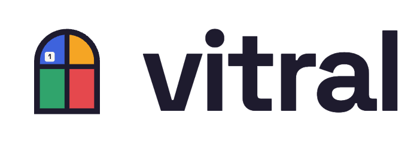

<p align="center">
  <picture>
    <source media="(prefers-color-scheme: dark)" srcset="assets/brand/logo-dark.png">
    
  </picture>
</p>

<p align="center"><strong>Uma janela que a IA consegue ler.</strong></p>

O Vitral deixa o GitHub Copilot usar um navegador de verdade enquanto você acompanha: abrir telas,
preencher formulários, tirar prints, conferir o que a API respondeu e repetir tarefas gravadas. Cada
pedaço da tela ganha um número e uma cor, e você vê na janela o que a IA vai fazer antes de ela fazer.

<!-- TODO: GIF da demonstração (roteiro em docs/demo.md) -->

## Comece em 3 passos

1. **Baixe** o Vitral do seu computador na [página de versões](https://github.com/JonathanSantos/vitral/releases)
   e descompacte.
2. **Rode** dentro da pasta do seu projeto, no terminal:

   ```bash
   vitral setup
   ```

   (no Mac, se aparecer um aviso de segurança na primeira vez: `xattr -d com.apple.quarantine vitral`)
3. **Abra o Copilot** no VS Code, no modo Agent, digite `/` e escolha um prompt do Vitral.

## O que dá para pedir

| Prompt | O que faz |
|---|---|
| `/vitral-descrever-tela` | Abre uma página e explica a tela em linguagem simples. |
| `/vitral-preencher-formulario` | Preenche um formulário com os dados que você colar e para antes de enviar. |
| `/vitral-testar-api-fora` | Mostra como a tela fica quando a API dá erro, demora ou cai. |
| `/vitral-gravar-fluxo` | Faz uma tarefa com você e salva para repetir depois. |
| `/vitral-executar-fluxo` | Repete uma tarefa gravada, passo a passo. |

Ou peça do seu jeito: *"Abra o portal de pedidos e busque o pedido 1023."*

O `vitral setup` também instala a **skill do Vitral** (`.github/skills/vitral/`, ou `~/.copilot/skills/vitral/`
com `--global`): são as regras que o Copilot segue ao usar o navegador, como explicar antes de agir,
pedir um "sim" antes de enviar qualquer coisa e nunca digitar senhas. O Vitral funciona sem ela, mas
com ela a IA trabalha com mais cuidado. Se você editar a skill, o setup pergunta antes de trocá-la.

## É seguro?

- **A IA usa um navegador próprio do Vitral**, baixado na primeira vez, com perfil separado. O seu
  Chrome não é usado, a menos que você permita.
- **Quem digita senhas é você.** Quando aparece um campo de senha, o Vitral pausa e mostra "Sua vez".
- **Você pode pausar a qualquer momento** pelo botão "⏸ Pausar IA" no canto da janela do navegador.
- **O cursor da IA é só visual.** Ele mostra, com a etiqueta "IA", onde a IA vai clicar, para você
  acompanhar. O clique de verdade acontece no ponto onde o cursor parou, sem passar por cima de nada
  no caminho. Ele não serve para disfarçar automação: o navegador continua identificado e o selo
  continua na tela. Para desligar: `"--cursor", "off"` em `args`.
- **Nada sai do seu computador** além do que a IA já vê no chat.

Algo estranho? Rode `vitral doctor`: ele confere tudo e diz o que fazer.

## Desligar o Vitral

Do mais rápido ao mais duradouro:

- **Agora, no meio de uma tarefa:** clique em "⏸ Pausar IA" no canto da janela do navegador.
  <!-- print: botão Pausar IA no selo -->
- **Só nesta conversa:** no chat do Copilot, clique no botão *Configure Tools* (o ícone de
  ferramentas, ao lado de onde você digita) e desmarque o Vitral.
  <!-- print: Configure Tools com o Vitral desmarcado -->
- **No VS Code, até você ligar de novo:** na barra lateral de extensões, seção *MCP SERVERS - INSTALLED*,
  clique com o botão direito em "vitral" e escolha *Disable*. Também dá pelo comando *MCP: List Servers*:
  escolha "vitral" e depois *Disable*. Vale para este projeto ou para todos, e não muda nenhum arquivo.
  <!-- print: menu Disable no servidor vitral -->
- **No Copilot CLI:** `/mcp disable vitral`.
- **Nos arquivos de configuração:** `vitral disable` desliga o Vitral em todos os arquivos onde ele está
  (`--workspace` só nesta pasta, `--global` só no usuário); `vitral enable` liga de novo. Para ver onde
  ele está configurado: `vitral status`.

---

## Para desenvolvedores

Servidor MCP (stdio) em Go, binário único, que controla um Chromium via [rod](https://github.com/go-rod/rod).
Especificação em [`docs/SPEC.md`](docs/SPEC.md), identidade em [`docs/BRAND.md`](docs/BRAND.md), experiência
de uso em [`docs/UX-TASKS.md`](docs/UX-TASKS.md) e roteiro de validação manual em
[`examples/vscode/CHECKLIST.md`](examples/vscode/CHECKLIST.md).

### Ferramentas MCP

| Grupo | Ferramentas |
|---|---|
| Navegação e ações | `open`, `snapshot`, `click`, `type`, `select`, `press`, `scroll`, `wait_for`, `back` |
| Visão | `screenshot` (com marcações por ref), `inspect` |
| Rede e console | `network_list`, `network_get`, `console_list` |
| Simulação | `mock_add`, `mock_list`, `mock_clear`, `emulate` |
| Fluxos | `flow_save`, `flow_list`, `flow_run`, `flow_update` |
| Opcional | `eval_js` (só com `--allow-eval`) |

As ações devolvem só o que mudou na tela. Enquanto a pessoa pausa, as ferramentas que agem respondem
(sem erro) que estão pausadas, e as de leitura continuam funcionando.

### Comandos e configuração

```bash
vitral                   # no terminal: ajuda; sem terminal (VS Code): servidor MCP
vitral setup [--global] [--yes]
vitral status
vitral disable [--workspace|--global]
vitral enable [--workspace|--global]
vitral doctor
vitral install-browser [--from chrome.zip]
vitral version
```

Cursor visual da IA ([`docs/CURSOR.md`](docs/CURSOR.md)), com janela visível:

| Flag | Valores | Padrão |
|---|---|---|
| `--cursor` | `on`, `off`, `force` (liga mesmo sem janela visível: testes e gravação de demos) | `on` |
| `--cursor-speed` | `slow`, `normal`, `fast`, `instant` | `normal` |
| `--flow-cursor-speed` | idem, durante `flow_run` | `fast` |
| `--cursor-seed` | inteiro (0 = aleatória por sessão) | `0` |
| `--type-pacing` | `on`, `off` (digitação tecla a tecla, só com janela visível) | `on` |

### Navegador

O Vitral usa o próprio Chrome for Testing, em versão fixada (`install.PinnedVersion`), instalado em
`~/.vitral/browsers/<versão>` (mantém só a atual e a anterior). A escolha segue esta ordem, e o motivo
aparece no log (stderr) e no `vitral doctor`:

1. `--browser-path` ou `VITRAL_BROWSER_PATH`;
2. Chrome for Testing gerenciado (baixa se faltar, validando com `--version` antes de instalar);
3. se o download falhar ou não houver build para a plataforma: o Chromium mais novo do cache do
   Puppeteer ou do Playwright (só o executável; nada de Node);
4. Chrome ou Edge do sistema, **só com `--allow-system-browser`**, sempre com o perfil do Vitral.

Redes corporativas: `VITRAL_BROWSER_MIRROR` (ou `--browser-mirror`) aponta para um mirror com o mesmo layout
de paths do Chrome for Testing, `HTTPS_PROXY`/`HTTP_PROXY` são respeitados, e
`vitral install-browser --from chrome.zip` instala um zip baixado à mão.

O `setup` instala o binário em `~/.vitral/bin` e grava a configuração no formato portável, que vale
para o VS Code (todos os perfis), o Copilot CLI e o Agent Host: `.mcp.json` na raiz do projeto, ou
`~/.copilot/mcp-config.json` (`$COPILOT_HOME/mcp-config.json`) com `--global`, na chave `mcpServers`,
preservando comentários e com `.bak` do arquivo anterior. Se o Vitral estiver no formato antigo do VS Code
(`.vscode/mcp.json` ou o `mcp.json` de um perfil, deprecados), o setup oferece tirá-lo de lá: com ele em
dois lugares, o VS Code sobe dois servidores. Rodar de novo com um binário novo é a forma de atualizar.

Não existe campo oficial de "desligado" no arquivo (o VS Code e o Copilot CLI guardam esse estado à
parte). Por isso o `vitral disable` move a entrada de `mcpServers` para a chave de topo `_disabled`: o
arquivo continua JSON válido para todas as ferramentas e o `enable` só a devolve. Os dois são
idempotentes, mostram cada arquivo alterado e guardam `.bak`.

Flags do servidor (também aceitas em `vitral.yaml` no diretório de trabalho):

| Flag | Padrão | Descrição |
|---|---|---|
| `--headless` | `false` | Navegador sem janela. |
| `--attach ws://…` / `--attach-port 9222` | | Conecta num Chrome aberto com `--remote-debugging-port` e um `--user-data-dir` separado. Nunca o fecha. |
| `--profile-dir` | `~/.vitral/profile` | Perfil dedicado do navegador. |
| `--browser-path` | | Usa este executável (env `VITRAL_BROWSER_PATH`). |
| `--browser-mirror` | | Mirror do Chrome for Testing (env `VITRAL_BROWSER_MIRROR`). |
| `--allow-system-browser` | `false` | Permite o Chrome/Edge instalado como último recurso. |
| `--browsers-dir` | `~/.vitral/browsers` | Onde ficam os Chrome for Testing baixados. |
| `--allowed-hosts` | | Hosts permitidos para navegação e mock (globs, separados por vírgula). |
| `--allow-eval` | `false` | Registra `eval_js`. |
| `--disable-mock` | `false` | Remove as ferramentas de mock. |
| `--highlight-ms` | `350` (0 em headless) | Tempo do destaque antes de cada ação; `0` desliga. |
| `--no-overlay` | `false` | Sem destaque e sem texto no selo; o botão de pausa continua. |
| `--stability-timeout` | `10s` | Espera máxima para a página assentar depois de cada ação. |
| `--nav-timeout` | `15s` | Tempo máximo de navegação. |
| `--flows-dir` | `.vitral/flows` | Onde os fluxos são salvos. |
| `--log-level` | `info` | Logs sempre em stderr; stdout é só do protocolo MCP. |

### Arquitetura

```
cmd/vitral          entrada: comandos para pessoas ou servidor MCP
internal/cli        setup, doctor, version e mensagens em PT-BR
internal/app        monta o servidor
internal/tools      ferramentas MCP (guard: pausa, selo "trabalhando", proteção contra panic)
internal/session    ações, espera por estabilidade, diff, gravação e replay de fluxos
internal/snapshot   JS embutido que lê a página + formatação e diff em Go
internal/overlay    selo, destaque, pausa e cursor visual injetados na página (shadow root fechado)
internal/cursor     física do cursor visual (pura, determinística pela semente)
internal/ux         máquina de estados do selo (pura)
internal/screenshot marcações desenhadas em Go
internal/network, console, mock, flow, browser, security, brand, config, ring
tools/brandgen      gera os PNGs da marca (não entra no binário)
tools/cursorlab     laboratório do movimento do cursor (make cursorlab)
```

### Limitações conhecidas

- **Pausar só com o teclado não funciona na v1.** Os botões do selo têm `tabindex="-1"` para que um
  `press Tab` da IA não caia neles e mude o foco da página. Quem usa apenas o teclado ainda não consegue
  pausar.

### Próxima versão

- Atalho de teclado para pausar e retomar, resolvendo a limitação acima sem expor os botões do selo
  à navegação por Tab da página.

### Testes e build

A estratégia completa está em [`docs/TESTING.md`](docs/TESTING.md) e os números do gate em
[`.quality/thresholds.yaml`](.quality/thresholds.yaml).

```bash
make check-fast    # lint + unitários com race + cobertura unitária (o mesmo do pre-push)
make check         # gate de PR: check-fast + govulncheck + integração + e2e + mutação + qualitygate
make integration   # integração com Chromium headless e páginas de testdata/
make visual        # regressão visual com navegador (make visual-update aceita as mudanças)
make matrix        # compila e checa os testes para Linux, macOS e Windows
make install-test  # instalação e atualização com binários reais
make nightly       # check + mutação completa + fuzz + download real + visual + matriz
make release-check # nightly + install-test (rodar em cada sistema)
make network       # download real do Chrome for Testing (≈150 MB, fora do gate)
make cursorlab     # laboratório do cursor: trajetórias, velocidade e palco
make demo-cursor   # janela visível com o roteiro do cursor em slow (para o GIF)
make build         # bin/vitral
make dist          # binários para Windows, macOS e Linux em dist/
make brand         # regenera os PNGs de assets/brand
```

Para um agente que não tem o Vitral como servidor MCP (simulações e avaliação com modelo real), a
ponte `tools/mcpbridge` sobe o binário real e expõe as ferramentas por HTTP local
(`GET /tools`, `POST /call`), com o registro de cada chamada:

```bash
go run ./tools/mcpbridge -log transcript.md -- bin/vitral --cursor-speed normal
```

Para rodar o gate rápido antes de cada push, ative o hook uma vez por clone:

```bash
git config core.hooksPath .githooks
```

O CI (`.github/workflows/pr.yml`) só chama `make check`. Releases com `goreleaser release --clean` a
partir de uma tag.
